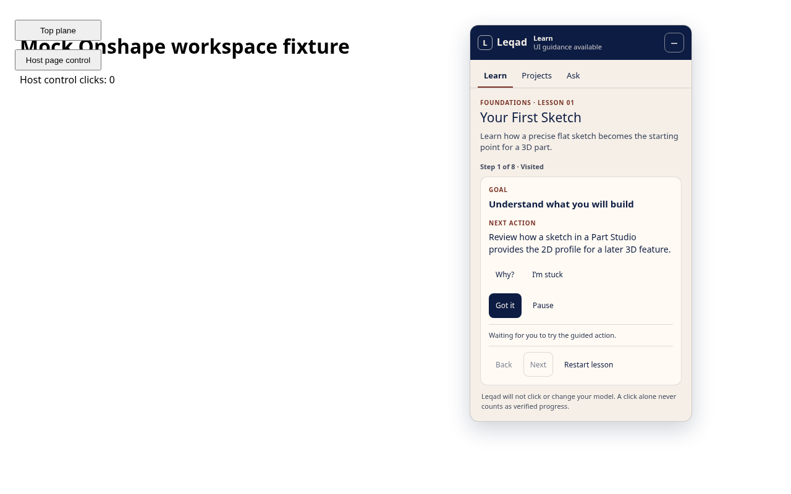

# Leqad

Leqad is an interactive CAD teaching assistant that runs inside Onshape. It keeps learners in their modeling workspace, points to recognized controls, gives progressively more detailed help, and records only the progress that its available evidence supports.

Phase 1 delivers one complete beginner lesson, **Your First Sketch**, in a WXT Manifest V3 extension for Chrome and Edge. The learner selects the Top plane, enters sketch mode, draws and dimensions a rectangle, finishes the sketch, and connects the 2D profile to later 3D features. Leqad never clicks or edits the model for the learner.



_Controlled browser fixture, not live Onshape compatibility evidence._

## What works now

- React interface mounted in an isolated Shadow DOM on supported Onshape document routes
- Leqad-branded panel with dragging, collapse/expand, keyboard movement, viewport clamping, and first-run onboarding
- Deterministic eight-step Foundations lesson with Next, Back, Why, Show me, progressive hints, pause/resume, restart, recovery, and independent practice
- Explicit acknowledgement, UI-verified, model-verified, unable-to-verify, and self-reported outcomes
- Conservative Onshape route and capability detection for workspaces, versions, microversions, editability, and Part Studio state
- Typed semantic recognition and nonblocking highlights for Sketch, Top plane, Rectangle, Dimension, and Finish sketch
- Lightweight local cursor-intent estimation with bounded memory; cursor data stays in the page and never verifies CAD progress
- Per-document lesson persistence, reload recovery, independent learning history, schema migration, and ordered writes
- Evidence contracts that reject stale, mismatched, mock, insufficient, or contradictory evidence in production transitions
- Reproducible Chrome and Edge MV3 builds and zip packages

## Current limits

- Live Onshape selectors and the complete lesson have not yet passed the Phase 1 live acceptance gate. Fixture tests do not prove compatibility with Onshape.
- Geometry, committed sketches, and the example 40 mm by 30 mm dimensions remain unknown without supported current model evidence.
- Visible Part Studio and Sketch controls do not establish editing permission. Workspace permission stays unknown; unsupported verification steps offer direct self-reported continuation.
- Model revision metadata and the Phase 2 verification backend are not connected.
- Projects and Ask are labeled previews. Contextual AI, custom-part design, robotics projects, and printability guidance remain roadmap work.
- Leqad currently requests only extension storage permission and does not include telemetry or a remote service.
- The repository has no active open-source license yet. Apache-2.0 is prepared as a proposal pending the repository owner's approval.

See [testing limitations](docs/testing/limitations.md) and the [current capability matrix](docs/testing/onshape-capability-matrix.md) for the evidence behind each statement.

## Architecture

The pnpm monorepo keeps browser UI, lesson policy, verification, and serialized contracts separate:

```text
apps/extension          WXT content script, React panel, Onshape observations
packages/lesson-engine  Deterministic lesson definitions and transitions
packages/cad-core       Evidence-satisfaction and model-verification policy
packages/contracts      Validated shared schemas and types
```

Dependency direction is `extension -> lesson-engine -> cad-core -> contracts`. Verification packages do not import browser UI code. Read the [architecture overview](docs/architecture/overview.md) for lifecycle and trust-boundary details.

## Browser targets

- Chrome Manifest V3: production build and controlled browser fixture tested
- Edge Manifest V3: production build and package tested; manual Edge loading still required
- Other Chromium browsers: unverified
- Firefox and Safari: unsupported in Phase 1

## Develop locally

Requirements:

- Node.js 22.12 or newer
- pnpm 11.25.0
- Chromium for the browser fixture tests

```sh
pnpm install --frozen-lockfile
pnpm dev
```

Run the full local checks:

```sh
pnpm lint
pnpm typecheck
pnpm test
pnpm format:check
pnpm build
pnpm build:edge
pnpm test:e2e
pnpm package:browsers
```

Detailed setup and unpacked loading instructions are in [local setup](docs/development/local-setup.md).

## Test tracks

- Unit and component tests cover contracts, trust policy, lesson transitions, persistence, recognition, cursor logic, and panel interactions.
- Browser fixture tests exercise the real React/Shadow DOM panel against controlled HTML. They remain fixture evidence.
- The unpacked Chrome extension test loads the production package when browser policy permits. A skip is reported as skipped.
- Live Onshape testing is a separate manual gate that requires an authorized account and disposable document.

Use the [live setup guide](docs/testing/live-setup.md) and [Onshape test procedure](docs/testing/live-onshape.md) before recording any compatibility claim.

Record PASS, FAIL, or BLOCKED plus a short observation in the [live acceptance checklist](docs/testing/results/phase1-live-acceptance.md). The [licensing comparison](docs/legal/apache-2.0-proposal.md) remains pending the owner's decision.

See the [latest Phase 1 validation report](docs/testing/results/phase1-final-validation.md) for current test results and blockers.

## Security and privacy

Leqad stores lesson state and panel preferences in browser extension storage. Cursor samples are bounded, local, short-lived, and never transmitted. The extension has no telemetry, no model-generated code execution, and no permission to read unrelated sites. Report vulnerabilities through the process in [SECURITY.md](SECURITY.md).

## Project direction

The original product vision includes Foundations, guided custom-part design, contextual AI assistance, robotics applications, and printability guidance. Phase 1 establishes the teaching interface and evidence boundaries needed for that work. See [ROADMAP.md](ROADMAP.md) and the preserved [product sources](docs/product/phase-1-scope.md).

Contributions are welcome under [CONTRIBUTING.md](CONTRIBUTING.md) and the [Code of Conduct](CODE_OF_CONDUCT.md). Licensing remains pending owner approval; contribution terms will be finalized with that decision.
