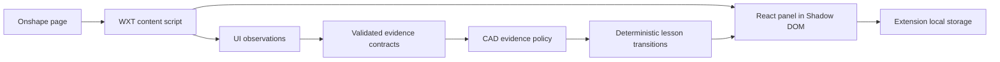

# Architecture overview

Leqad Phase 1 is a local-first browser extension with deterministic lessons and explicit evidence boundaries. The learner performs every CAD operation.

## Packages

| Area                     | Responsibility                                                                             | May depend on            |
| ------------------------ | ------------------------------------------------------------------------------------------ | ------------------------ |
| `packages/contracts`     | Serialized evidence, identity, condition, and decision schemas                             | Zod                      |
| `packages/cad-core`      | Production/fixture evidence policy and model-condition evaluation                          | Contracts                |
| `packages/lesson-engine` | Lesson definitions, step state machine, session reconciliation                             | CAD core, contracts      |
| `apps/extension`         | WXT lifecycle, Onshape observations, React UI, storage, targets, highlights, cursor intent | Lesson engine, contracts |

The dependency direction is acyclic: `extension -> lesson-engine -> cad-core -> contracts`. Browser UI code does not enter the verification packages.

## Browser lifecycle

The content script runs only on exact Onshape document paths allowed by the manifest. It parses the full document and workspace/version/microversion and element identity. A lifecycle coordinator permits one active or pending panel for that context, removes the prior React root on navigation, and rejects late asynchronous initialization.

The panel mounts through WXT in a Shadow DOM. The host passes pointer events through except for the panel itself. Navigation or invalidation removes the root, active highlight, timer, observers, and React listeners.

## Evidence boundary

A lesson step declares an evidence requirement. A transition receives a complete validated decision rather than a bare status. Production policy checks source, evidence level, identity, revision, timestamp, expiry, intended feature, contradictions, units, and explicit tolerances.

Supported UI observations may complete UI-only steps. They cannot prove committed geometry or API-required values. Mock evidence is allowed only under an explicit fixture policy and cannot satisfy production transitions.

## Onshape observations

Routes identify document context, not editing permission or Part Studio type. Those capabilities stay unknown until supported UI or API evidence establishes them. Current semantic matching favors exact accessible labels and titles, rejects ambiguous/hidden/disabled/obscured controls, and has no unvalidated permanent Onshape selector table.

Part Studio and Sketch controls do not establish editing permission. The current content script has no positive permission observer, so workspace permission remains UNKNOWN; read-only routes and supported read-only indicators remain conservative. The typed capability API accepts explicitly scoped observations, but no Onshape API provider is connected.

The content script and panel use the same two-observer registry: current Top-plane selection and current sketch-editing controls. Sketch-mode evaluation does not require a plane to remain selected and does not reuse historical selection to claim plane association. Both observers still require an editable Part Studio context, matching identity, fresh evidence, and no contradictory selected reference plane. Rectangle creation, dimensions, and finished sketch state have no observer and offer direct continuation as SELF_REPORTED/UNKNOWN.

## Persistence

Extension storage separates:

- Learning history: visits, concepts, hints, attempts
- Model session: document/workspace/element, step states, observations, verified facts, evidence references and freshness
- Panel preferences: position, collapsed state, onboarding completion

Model-dependent progress is invalidated when the revision changes or is unknown. Acknowledgement and self-reported learning progress are preserved. Per-key write queues prevent an older delayed write from winning.

## Deferred architecture

Phase 1.5 may add the conversational teacher and optional authorized screenshot
grounding described in the preserved October 15 design. Phase 2 adds secure CAD
API/model verification; Phase 3 adds custom-part concepts and learner-controlled
plans. These systems are not present. They must use explicit evidence boundaries
and preserve learner control and privacy. See the
[current phase matrix](../product/phase-feature-matrix.md). Future CAD adapters
must supply platform-specific context, target/UI observations and model facts;
shared lesson policy must remain independent of browser and Onshape selectors.
