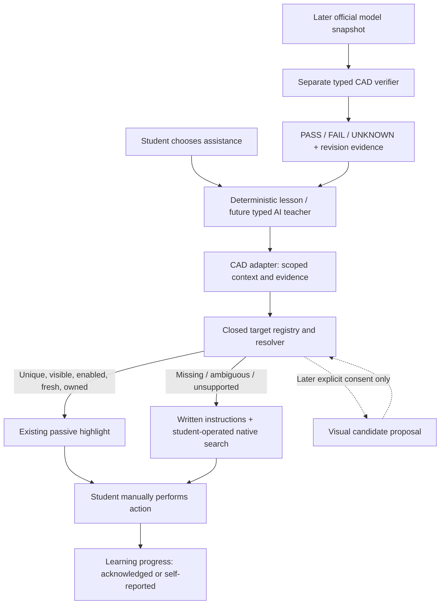

# Onshape existing systems evaluation and Phase 1 completion plan

Research date: October 16–17, 2026. Baseline: [PR #8](https://github.com/anandanikait-bot/leqad/pull/8), commit [`4be3602`](https://github.com/anandanikait-bot/leqad/tree/4be3602fa322a744e720723175b90c14b65c105a). Research and one isolated experiment are on a separate branch. **Phase 1 acceptance remains incomplete.** This report neither changes SHOW acceptance nor introduces production selectors.

## Executive decision

Retain Leqad's passive outline, typed guidance registry and deterministic runner. Reuse **Onshape's documented, student-operated Search Tools** as an optional instructional fallback. Reuse **Playwright's strictness, actionability and fresh-resolution principles**, already partly present in Leqad, rather than importing an automation runtime. Keep a hybrid architecture: verified DOM targets first, explicit native/manual fallback when unavailable, and separately authorized visual assistance later.

No reviewed system supplies independently validated, production-safe Sketch context and Rectangle-arrow ownership for the owner's current Onshape interface. Onshape MX is the most relevant concrete implementation to investigate, but its private DOM assumptions and unsafe first-match shortcuts are not evidence that its selectors work in this build. Another highlight library would not resolve this gap.

**One prototype:** [manual Search Tools instruction card](../../experiments/native-search-fallback/README.md). It tests a useful fallback without replacing recognition. No additional prototypes or dependencies were introduced. No authenticated Onshape test was performed in this research sprint.

### Deliverable index

| Requested deliverable            | Location                                                                                                                                  |
| -------------------------------- | ----------------------------------------------------------------------------------------------------------------------------------------- |
| A: sourced research              | Sections 1–6; [highlight source review](highlight-systems-source-review.md); [recognition source review](ui-recognition-source-review.md) |
| B: reuse recommendations         | Section 7 and the two source-review matrices                                                                                              |
| C: architecture                  | Section 8                                                                                                                                 |
| D: completion plan and estimates | Section 10                                                                                                                                |
| E: one tested experiment         | Section 9 and experiment README                                                                                                           |
| F: risk register                 | Section 11                                                                                                                                |
| G: four explicit final decisions | Section 12                                                                                                                                |

## 1. What actually needs solving

### Evidence discipline

- **Documented:** a vendor describes supported functionality; not proof of our integration.
- **Source-reviewed:** inspected implementation at a pinned commit; not a successful installed build.
- **Simulated:** a local fixture/test models behavior; not actual Onshape evidence.
- **Owner-reported live:** supplied observations, scoped to that build/session; not independently reproduced here.
- **Current live acceptance:** an identified build, browser and observed result recorded against the checklist. None is newly established here.

The latest Sketch-versus-Extrude evidence is the **owner's summary in the task**, not a newly inspected raw capture. At `4be3602`: Sketch/Extrude candidate regions 3/2, allowlisted labels 1/0, semantic toolbars 0/0, both scans exhausted and reports truncated, neither editor-specific identity verified. The Sketch `Corner rectangle` text was hidden and nonactionable. Both had similar three-branch SVG dialogs with UNKNOWN visibility. These differences cannot safely become selectors. A limit is incomplete inspection, not proof of absence. UNKNOWN is not hidden, disabled or inactive.

Historical owner reports establish that Top highlighting worked in a previous authorized session. They do not establish this build's entire browser matrix and never prevent fresh testing. Prior Finish/Cancel outcomes identify those user actions, not a unique Sketch-specific dialog signature.

### Six independent problems

| Problem                           | Existing Leqad boundary                                                                                                                                                                                                                | Reuse opportunity / remaining gap                                                                                                                                                                              |
| --------------------------------- | -------------------------------------------------------------------------------------------------------------------------------------------------------------------------------------------------------------------------------------- | -------------------------------------------------------------------------------------------------------------------------------------------------------------------------------------------------------------- |
| A: current CAD context            | [sketchGuidance.ts](../../apps/extension/src/services/sketchGuidance.ts), page scope, supported Sketch UI evidence                                                                                                                     | Official model APIs do not document transient active-tool observation. Need an independently distinctive current editor signature, not generic dialogs or visible toolbar permissions.                         |
| B: exact command                  | [semanticTargets.ts](../../apps/extension/src/services/semanticTargets.ts), [semanticTargetDom.ts](../../apps/extension/src/services/semanticTargetDom.ts), [referencePlanes.ts](../../apps/extension/src/services/referencePlanes.ts) | Playwright validation principles transfer; CAD identity still requires a validated domain rule. Top's local feature-list rule is not a toolbar rule.                                                           |
| C: group, arrow, menu and variant | Existing Rectangle SHOW lookup, eligibility and owner checks in semanticTargets                                                                                                                                                        | MX demonstrates concrete split-control relationships worth checking. Its assumptions are not approved Leqad identities. Last-used face command cannot be equated with Corner rectangle or the dropdown opener. |
| D: visual outline                 | `createHighlightOutline`, `createTargetHighlight`, `createSemanticHighlighter` in semanticTargets; [calibratedHighlight.ts](../../apps/extension/src/services/calibratedHighlight.ts) is explicitly approximate                        | Already passive, transient and revalidated. Retain. Tour libraries add behavior without solving A–C.                                                                                                           |
| E: teaching/recovery              | [guidanceRegistry.ts](../../apps/extension/src/services/guidanceRegistry.ts), [guidanceRunner.ts](../../apps/extension/src/services/guidanceRunner.ts), panel and lesson                                                               | Keep closed identities and HINT/SHOW boundaries; native search can teach the action without invented recognition. Unsupported GUIDE remains unavailable.                                                       |
| F: model verification             | Current steps distinguish acknowledgment/self-report from supported observations                                                                                                                                                       | Later official APIs, immutable model snapshots and explicit predicates. UI interaction, highlights and lesson progress are not geometry proof.                                                                 |

### Discovery versus production

[editorRegionDiscovery.ts](../../apps/extension/src/services/editorRegionDiscovery.ts) and [sketchEditorComparisonCapture.ts](../../apps/extension/src/services/sketchEditorComparisonCapture.ts) provide bounded diagnostic discovery and comparative observations. Their larger scan budgets, candidate counts and truncation reporting do not authorize production targeting. The current Rectangle failure `NO_TOOLBAR_SEMANTICS` is distinct from failed Sketch context and target eligibility. Replacing the renderer cannot change any of those rejection reasons.

Reviewed [semantic target tests](../../apps/extension/src/services/semanticTargets.test.ts), [Sketch tests](../../apps/extension/src/services/sketchGuidance.test.ts), [reference-plane tests](../../apps/extension/src/services/referencePlanes.test.ts), [comparison tests](../../apps/extension/src/services/sketchEditorComparisonCapture.test.ts), and [browser fixtures](../../apps/extension/tests/e2e). They establish regression boundaries for synthetic structures. Mocked rectangles plus resize/scroll are not actual Chrome toolbar zoom.

Product sources remain [Phase 1 scope](../product/phase-1-scope.md), [master roadmap](../product/leqad-master-vision-roadmap.md), [implementation specification](../product/leqad-master-implementation-spec.md), and the [28-case current acceptance checklist](../testing/results/2026-10-15-foundations-live-acceptance.md). Deterministic lessons, self-report and UI guidance belong to Phase 1; consented AI/vision and authenticated model verification remain later work.

## 2. Onshape-native capabilities first

### 2.1 Search Tools: all ten questions

Primary sources: [Search Tools](https://cad.onshape.com/help/Content/Home/search_tools.htm), [Sketch tools](https://cad.onshape.com/help/Content/Sketch/sketch_tools.htm), [feature tools](https://cad.onshape.com/help/Content/PartStudio/feature_tools.htm), [icon glossary](https://cad.onshape.com/help/Content/Home/icon_glossary.htm). Reviewed official help, not an inferred DOM interface.

| Question                                        | Finding and limit                                                                                                                                                                                                                                                                                                      |
| ----------------------------------------------- | ---------------------------------------------------------------------------------------------------------------------------------------------------------------------------------------------------------------------------------------------------------------------------------------------------------------------- |
| 1. Searchable tools?                            | Help documents Sketch, Part Studio and Assembly tools. This is command discovery, not an API catalog or proof of every account/context result.                                                                                                                                                                         |
| 2. Native highlighting?                         | Search provides an optional “Highlight tool in toolbar” setting; hovering a result invokes Onshape's own toolbar highlight. Leqad need not draw that highlight.                                                                                                                                                        |
| 3. Sketch and variants?                         | Sketch tools are covered and official help names Corner rectangle/Center point rectangle and circle/arc variants. Exact result coverage and current availability of every variant still need a live check.                                                                                                             |
| 4. During Sketch editing?                       | Official Sketch help documents search in that toolbar. Our integration has not been exercised live here.                                                                                                                                                                                                               |
| 5. Rectangle/Circle/Line/Arc/Dimension/Extrude? | These are documented commands in the relevant tool families. Search is documented for those families; do not claim all six individual result states were observed. Rectangle means an exact named variant, not a generic family face.                                                                                  |
| 6. Unavailable commands?                        | Help says tools removed from the toolbar remain searchable and usable. Removed is not equivalent to disabled, forbidden or contextually unavailable. Disabled-result rendering/selection behavior is not established by these sources; do not promise it.                                                              |
| 7. Highlight boundary?                          | Documentation promises toolbar highlighting, not an exact arrow rectangle, main-button boundary or menu-option highlight. Owner observation is required before making that stronger claim.                                                                                                                             |
| 8. Programmatic integration?                    | No supported search/query/invoke interface found in the reviewed official extension messages/API docs. This is a scoped negative finding, not a claim about all private APIs. Do not simulate shortcuts or dispatch private commands.                                                                                  |
| 9. Safe manual guidance?                        | Yes as documented instructions: user opens toolbar Search Tools or Alt/Option+C, types the exact name, reads the result, optionally uses native highlight, and selects it themselves. If hidden, help documents a toolbar context-menu visibility option. Custom shortcuts and unavailable results need fallback copy. |
| 10. Reduce custom recognition?                  | Yes for manual teaching and recovery. It does not satisfy a requirement that Leqad automatically highlight the exact control. Counting it as automatic SHOW would require owner approval.                                                                                                                              |

The toolbar group icon can reflect the last selected variant ([Sketch tools](https://cad.onshape.com/help/Content/Sketch/sketch_tools.htm)). Teach **Corner rectangle** explicitly: opposite corners, unlike a center-based rectangle. Similar future instructions can name a particular circle or arc. Do not infer an open menu from the group face. The help also documents that starting Extrude/Revolve from Sketch accepts and exits Sketch; that UI capability is not permission for Leqad to automate it.

### 2.2 Official extension and model interface boundaries

An Onshape registered application extension is an embedded app with documented messaging/authentication, **not automatically a Chrome content script**. See [app extensions](https://onshape-public.github.io/docs/app-dev/extensions/), [element-right-panel messages](https://onshape-public.github.io/docs/app-dev/messages/element-right-panel/), [element-tab messages](https://onshape-public.github.io/docs/app-dev/messages/element-tab/).

| Capability                             | Documented mechanism                                                                                                                                                                        | What it does not establish                                                                                                 |
| -------------------------------------- | ------------------------------------------------------------------------------------------------------------------------------------------------------------------------------------------- | -------------------------------------------------------------------------------------------------------------------------- |
| App document/workspace/element context | App launch parameters and `applicationInit`, origin/context-scoped messaging                                                                                                                | Current transient Sketch editor or write permission from a visible control; context IDs must not enter diagnostic exports. |
| Selection observation/request          | Entity selection messages/types and scoped identifiers                                                                                                                                      | Selected toolbar tool or correct final geometry. An entity tagged as sketch-related is not active Sketch editing.          |
| Highlight CAD entities                 | `requestSelectionHighlight` addresses entities/bodies/geometry                                                                                                                              | Toolbar buttons, split arrows or dropdown items.                                                                           |
| Viewer image                           | `requestViewerImage` documents viewer image data                                                                                                                                            | Full application toolbar capture or an alternative to screenshot consent.                                                  |
| Open/close feature dialog              | `openFeatureDialog` / `closeFeatureDialog(accept)` are documented commands                                                                                                                  | Passive active-editor observation. These can change editing state and must not be invoked by guidance.                     |
| Read feature definitions               | [Features API](https://onshape-public.github.io/docs/api-adv/featureaccess/), [Part Studios](https://onshape-public.github.io/docs/api-adv/partstudios/)                                    | Which dropdown is open or which command a student is about to use.                                                         |
| Evaluate geometric queries             | [FeatureScript evaluation](https://onshape-public.github.io/docs/api-adv/fs/), including lambda evaluation and tight bounding boxes                                                         | UI state, a universal correctness oracle, or permission to execute arbitrary generated scripts.                            |
| Stable observation scope               | [workspace/version/microversion architecture](https://onshape-public.github.io/docs/api-intro/architecture/), [associativity](https://onshape-public.github.io/docs/api-adv/associativity/) | Multiple reads of a moving workspace being one consistent snapshot; entity IDs remaining globally stable.                  |
| Authorization                          | [OAuth](https://onshape-public.github.io/docs/auth/oauth/), [response/permission errors](https://onshape-public.github.io/docs/api-adv/errors/)                                             | Chrome activeTab granting model API access, or a toolbar proving edit rights.                                              |

No transient current-editor event, selected-toolbar-command getter or toolbar-highlight message was found in the reviewed documented interfaces. Private Angular services observed in public extensions are a different trust/maintenance category. New app registration, OAuth/token storage and model permissions are not introduced here. Future backend credentials must remain outside browser bundles; scopes and retention need explicit review.

### 2.3 Existing Onshape implementations

The [recognition source review](ui-recognition-source-review.md#actual-onshape-browser-integrations) inspects **Onshape MX** and **Rally for Onshape**, not repositories merely mentioning CAD. MX has command/icon catalogs and split-dropdown logic; Rally accesses private Angular command services. Neither was independently live-tested here. Their author reports/store listings are separately labeled, and source weaknesses are documented. An official native tutorial demonstrates pedagogy but supplies no reusable checker implementation. [CAD Learner](#6-future-model-verification-reuse) supplies an actual educational API backend, not toolbar recognition. No production-ready, independently verified accessibility adapter or CAD tutor solving the owner's exact missing identity was found in this search; that is not proof that none exists.

## 3. Highlight systems

See [source review](highlight-systems-source-review.md) for pinned commits/licenses and all requested dimensions: browsers, TypeScript/React, MV3/CSP, roots, positioning, dropdowns, scrolling, browser zoom, keyboard/focus, motion, cleanup, weight and pointer interception.

| System                 | Most consequential source finding                                                                                                                                          | Decision                                                                                            |
| ---------------------- | -------------------------------------------------------------------------------------------------------------------------------------------------------------------------- | --------------------------------------------------------------------------------------------------- |
| Existing Leqad outline | Passive `pointer-events:none`, reduced-motion handling, measured target bounds, five-second lifetime, mutation/scroll/resize invalidation and repeated semantic resolution | **ADOPT / retain**. No measured evidence that replacement improves it.                              |
| Driver.js 1.10.1       | MIT; core CSS disables interaction outside target/popover and keyboard events trap focus. A transparent mask alone does not remove these behaviors.                        | **REFERENCE ONLY**; hints entry may inform future explanation UI.                                   |
| React Joyride 3.2.0    | MIT; current version uses Floating UI. Portal, focus and overlay state duplicate our lifecycle; size-limit budget is not measured bundle size.                             | **DEFER** until a real tour UI need.                                                                |
| Shepherd 15.3.0 source | AGPL/commercial policy; optional modal has recurring animation-frame work and input masking.                                                                               | **REJECT present adoption**; licensing and behavior need explicit review.                           |
| Floating UI DOM 1.8.0  | MIT; focused placement/overflow/update primitives, open-shadow traversal and cleanup without requiring a modal                                                             | **PROTOTYPE later only if anchored explanations need it**. Not the selected experiment this sprint. |

No package was benchmarked inside Onshape. Build targets and CSS-zoom tests are not Chrome/Edge toolbar-zoom acceptance. No defensible bytes/CPU/latency improvement can be claimed. Measure against the same real document before changing the renderer. More tour features are not a benefit when they interfere with canvas input or shortcut focus.

## 4. Recognition systems

The [recognition review](ui-recognition-source-review.md) contains actual code paths, pinned licenses, current activity, privacy/permissions, a seven-property transfer analysis and MX's detailed ownership failure modes.

| Candidate     | Useful mechanism                                                                    | Missing guarantee / decision                                                                                                                           |
| ------------- | ----------------------------------------------------------------------------------- | ------------------------------------------------------------------------------------------------------------------------------------------------------ |
| Page Modeller | Ranked accessible/text/CSS/XPath locators, counts, open-shadow/frame paths          | GPL-3.0-or-later; no exact CAD semantics. **REFERENCE ONLY**, optional standalone inspection; no source copying without a licensing decision.          |
| VeraAura      | Real MV3 tutorial schema, overlay, progress and SPA handling                        | No license grant found; first-match targeting, stale listeners, learner email/progress export. **REJECT code integration**, conceptual reference only. |
| Playwright    | Strict matching, fresh resolution, independent visibility/enabled/hit-target checks | Apache-2.0; cannot infer CAD identity. **ADOPT principles and existing test use**; no automation runtime inside product.                               |
| Finder        | Unique selector for a known chosen node, including shadow-root scope                | MIT; unique locator can target wrong command after rearrangement. **REFERENCE ONLY**, optional dev aid, not identity provider.                         |
| Stagehand     | Actual current MV3/CDP/AX snapshot and model observation                            | MIT source, separate provider terms; debugger/all-host/model exposure, probabilistic actions. **DEFER**.                                               |
| browser-use   | CDP DOM/AX/layout representation, bounded protocol operations                       | MIT; external Python/browser/model stack and telemetry considerations. **DEFER**.                                                                      |
| Onshape MX    | Command IDs/icons plus face/dropdown mapping                                        | MIT; first match, weak box eligibility, global menu lookup and mutable cached owner. **REFERENCE ONLY** until independently corroborated.              |
| Rally         | Actual Onshape command catalog through private Angular bridge                       | MIT; private services, main-world hooks, no stable public API or arrow proof. **REFERENCE ONLY**; do not adopt private runtime dependency.             |

For any future rule, validate independently: **identity; parent/group ownership; arrow bounds; visibility/enabledness; uniqueness; observation generation; invalidation on replacement/navigation**. These are not interchangeable scores. A unique SVG is still not an identified CAD action. Reuse validator mechanics across tools, not unverified command IDs, icon names or menu topology. Existing capture evidence should be compared with public-code hypotheses before requesting any narrowly missing observation; do not repeat identical scans.

## 5. Vision approaches

### Reviewed implementations and licensing

| Source and inspected revision                                                                                                                | Findings                                                                                                                                                                                                                                                                                                                                                                                                                                                                                                                                                                                                                                                                      | Decision                                                                                                |
| -------------------------------------------------------------------------------------------------------------------------------------------- | ----------------------------------------------------------------------------------------------------------------------------------------------------------------------------------------------------------------------------------------------------------------------------------------------------------------------------------------------------------------------------------------------------------------------------------------------------------------------------------------------------------------------------------------------------------------------------------------------------------------------------------------------------------------------------- | ------------------------------------------------------------------------------------------------------- |
| [Microsoft OmniParser](https://github.com/microsoft/OmniParser/tree/354021201345a96178360b28733573e27269f2de), observed commit July 19, 2026 | [Parser](https://github.com/microsoft/OmniParser/blob/354021201345a96178360b28733573e27269f2de/util/omniparser.py) combines OCR/detector/caption into image boxes; [utilities](https://github.com/microsoft/OmniParser/blob/354021201345a96178360b28733573e27269f2de/util/utils.py) need Python/model runtime. Root [LICENSE](https://github.com/microsoft/OmniParser/blob/354021201345a96178360b28733573e27269f2de/LICENSE) is **CC BY 4.0**, despite README MIT badge. README describes differing detector/weight licenses, including older AGPL dependencies. Exact artifact/dependency terms must be resolved before adoption. [Paper](https://arxiv.org/abs/2408.00203). | **DEFER**; promising candidate proposals, no Onshape command or owner proof. No weights downloaded/run. |
| [UI-TARS](https://github.com/bytedance/UI-TARS/tree/582f3a7ea5d285ee8ed9e2e84048d1ab01453c49), observed commit September 5, 2025             | Apache-2.0 [source license](https://github.com/bytedance/UI-TARS/blob/582f3a7ea5d285ee8ed9e2e84048d1ab01453c49/LICENSE); [coordinates](https://github.com/bytedance/UI-TARS/blob/582f3a7ea5d285ee8ed9e2e84048d1ab01453c49/README_coordinates.md) require scaling; [action parser](https://github.com/bytedance/UI-TARS/blob/582f3a7ea5d285ee8ed9e2e84048d1ab01453c49/codes/ui_tars/action_parser.py) includes desktop actuation. Separate model-weight terms must be checked. [Paper](https://arxiv.org/abs/2501.12326).                                                                                                                                                      | **DEFER grounding only**, reject autonomous actuation for current product.                              |
| [SeeClick](https://github.com/njucckevin/SeeClick/tree/0ef37ac4d7aaf37ba7b990e3e3c3ca77e1fb8f93), observed commit July 13, 2025              | [README](https://github.com/njucckevin/SeeClick/blob/0ef37ac4d7aaf37ba7b990e3e3c3ca77e1fb8f93/readme.md) and [ScreenSpot evaluator](https://github.com/njucckevin/SeeClick/blob/0ef37ac4d7aaf37ba7b990e3e3c3ca77e1fb8f93/pretrain/screenspot_test.py) provide screenshot grounding implementation. No explicit source LICENSE found; README says datasets/checkpoints retain original terms. That is not a clear code license. [Paper](https://arxiv.org/abs/2401.10935).                                                                                                                                                                                                     | **REFERENCE ONLY** research; no code copying until grant established.                                   |

Commit activity is not the latest released model, support promise or compatibility benchmark. General ScreenSpot/web-agent results do not measure Onshape, tiny split arrows, customized CAD toolbars or false-positive safety. None of these models was executed here. Hosted multimodal APIs are also possible under the existing local-server proposal, but no specific model/provider benchmark was performed; do not assume they outperform these implementations.

### Five-approach comparison

Cost/latency below are qualitative architectural expectations, **not measurements**. No dollar price or millisecond result is asserted.

| Approach                          | Identity/arrow and Onshape reliability                                                                                                                          | Zoom/layout and DOM binding                                                                                                            | Latency/cost, privacy and confirmation                                                                                                                         |
| --------------------------------- | --------------------------------------------------------------------------------------------------------------------------------------------------------------- | -------------------------------------------------------------------------------------------------------------------------------------- | -------------------------------------------------------------------------------------------------------------------------------------------------------------- |
| A: DOM semantics                  | Deterministic when validated identity/ownership exists; current Sketch/Rectangle evidence insufficient. Last-used icon and unnamed arrow remain gaps.           | Live element bounds can track layout; stale/duplicate targets must invalidate. Native zoom still needs actual browser testing.         | Local computation, no model inference; bounded scans can still be expensive. No screenshot; user performs all actions.                                         |
| B: image localization             | Can propose visually plausible toolbar areas, but similar icons/small arrows can be confused. No demonstrated Onshape reliability here.                         | Requires screenshot-to-CSS mapping and fresh viewport; zoom/resizing invalidates old boxes. Pixels alone do not establish a DOM owner. | Inference/network or local model cost; potential private CAD exposure. Explicit one-shot consent and uncertain-result confirmation required; no identity PASS. |
| C: hybrid DOM + visual validation | Useful to cross-check a candidate against observed UI, not to promote two weak guesses into certainty. Domain identity and group ownership still need evidence. | Bind box to current eligible DOM candidates, reject overlaps/multiple hits, scope to generation. Abort on layout/context change.       | More implementation/runtime cost than A; same screenshot controls as B. Human confirmation cannot magically certify geometry or unsupported command identity.  |
| D: native Search Tools            | Vendor handles search/highlight semantics; exact results and boundaries still need owner trial. Student reads the exact variant.                                | Native implementation owns layout; Leqad obtains no trusted DOM target or arrow proof from it.                                         | User interaction time, no Leqad inference/screenshot cost. Best immediate documented fallback, not automatic SHOW success.                                     |
| E: manual calibration             | Student indicates a region; approximate assistance, not verified identity. Can point to the wrong button/arrow.                                                 | Existing calibration invalidates viewport/DPR/scale/context changes; ephemeral bounds are essential.                                   | Local and explicit; no inference. Human indication is the evidence class, never automatic control verification.                                                |

Future screenshot work must follow the [existing one-shot consent design](../superpowers/specs/2026-10-15-first-intelligent-interaction-design.md) and [Chrome captureVisibleTab permissions](https://developer.chrome.com/docs/extensions/reference/api/tabs#method-captureVisibleTab): user request, toolbar activeTab confirmation, current tab/origin checks, bounded capture, no automatic retries or continuous recording, viewport/DPR/zoom mapping and immediate invalidation. Minimize/redact private content before transmission; do not assume a full screenshot is safe merely because consent exists. Reconfirm the actual shipped manifest before implementation. A visual box may assist teaching; it cannot certify geometry.

## 6. Future model-verification reuse

This section is a roadmap, not Phase 2 implementation. No account access, API key, OAuth setup, native host, model write or network service was added.

### Onshape CadScript

Inspected [ricokahler/onshape-cadscript](https://github.com/ricokahler/onshape-cadscript/tree/8105dd2b5ea4c1d9b5df3b27c61d08780f922893), observed July 11, 2026 commit; [MIT LICENSE](https://github.com/ricokahler/onshape-cadscript/blob/8105dd2b5ea4c1d9b5df3b27c61d08780f922893/LICENSE). It is an unofficial typed model-authoring DSL, not an Onshape-supported active-tool observer. Its [README](https://github.com/ricokahler/onshape-cadscript/blob/8105dd2b5ea4c1d9b5df3b27c61d08780f922893/README.md) describes a signed-in Chrome extension/native bridge, dedicated modeling context, exact plan application and an initially macOS-focused setup. That is not a Windows-ready drop-in teaching verifier.

Useful patterns in [client](https://github.com/ricokahler/onshape-cadscript/blob/8105dd2b5ea4c1d9b5df3b27c61d08780f922893/packages/cadscript/src/onshape/client.ts) and [planner](https://github.com/ricokahler/onshape-cadscript/blob/8105dd2b5ea4c1d9b5df3b27c61d08780f922893/packages/cadscript/src/runtime/planner.ts): feature definitions/status, before/after observations, revision checks and owned feature plans. Important limits: missing status can default to `ok`; revision extraction can fall back to serializationVersion or `unknown`; a stale check is conditional on a known base revision. Serialization format version is not a model revision. A Leqad verifier must fail closed on those gaps, pin reads to one model snapshot, and avoid the author's write/apply path.

[measure.ts](https://github.com/ricokahler/onshape-cadscript/blob/8105dd2b5ea4c1d9b5df3b27c61d08780f922893/packages/cadscript/src/measure.ts) evaluates body bounds and approximate mass with a fixed PLA density. Such metrics do not prove rectangle topology, dimensional constraints, intended plane or how a learner constructed the part. **REFERENCE ONLY now**; small read-only API patterns may be reusable after a separate security/version-consistency review. Do not install its bridge to solve a toolbar problem.

### Other concrete clients and educational implementations

| Candidate                  | Source/license/activity                                                                                                                                                                                                                         | Benefit and limits                                                                                                                                                                                                                                                                                                                                                                     | Decision                                                                      |
| -------------------------- | ----------------------------------------------------------------------------------------------------------------------------------------------------------------------------------------------------------------------------------------------- | -------------------------------------------------------------------------------------------------------------------------------------------------------------------------------------------------------------------------------------------------------------------------------------------------------------------------------------------------------------------------------------- | ----------------------------------------------------------------------------- |
| Official generated clients | [onshape-clients](https://github.com/onshape-public/onshape-clients/tree/4f613cc4025a90e11493e2b79560afe9762e1686), MIT root license; archived, observed November 15, 2021 commit                                                               | API structure examples; old generated bindings/credential configuration, not current UI state.                                                                                                                                                                                                                                                                                         | **REFERENCE ONLY**, avoid adopting stale client wholesale.                    |
| Official TS sample         | [onshape-ts-client](https://github.com/onshape-public/onshape-ts-client/tree/3da53f9f5b532a91ef68eedd3dd2d540168efea2), observed June 28, 2026; package declares Apache-2.0 but no standalone license file found                                | [API client](https://github.com/onshape-public/onshape-ts-client/blob/3da53f9f5b532a91ef68eedd3dd2d540168efea2/utils/apiclient.ts) demonstrates signing and Node credential handling. Not MV3 frontend code; clarify actual reuse grant before copying.                                                                                                                                | **REFERENCE ONLY** pending license/distribution clarification.                |
| PTC Education CAD Learner  | [cad-learner](https://github.com/PTC-Education/cad-learner/tree/ca2ff313313d95dd0ef58a6a47a3bd52c4491fcb), [MIT](https://github.com/PTC-Education/cad-learner/blob/ca2ff313313d95dd0ef58a6a47a3bd52c4491fcb/LICENSE); observed February 7, 2025 | [models.py](https://github.com/PTC-Education/cad-learner/blob/ca2ff313313d95dd0ef58a6a47a3bd52c4491fcb/questioner/models.py) stores attempts/microversions and compares mass, volume, area and inertia with tolerances. Real educational backend, but aggregate properties do not uniquely prove shape or feature construction. OAuth/backend/data collection require separate review. | **REFERENCE ONLY**, later granular verifier design; not a Phase 1 dependency. |

### Required future verifier contract

| Question                    | Future supported evidence / caveat                                                                                                                                                                                                    |
| --------------------------- | ------------------------------------------------------------------------------------------------------------------------------------------------------------------------------------------------------------------------------------- |
| Snapshot and revision       | Authenticate a minimal read scope; identify document/element/configuration and immutable version/microversion internally. Never mix feature/geometry reads from changing workspace heads; abort/retry explicitly on inconsistency.    |
| Feature type/history        | Read feature list/status and typed definitions, check suppression/rollback/order where relevant. A feature named “Sketch 1” is not sufficient. API default-field omissions must be interpreted correctly.                             |
| Sketch plane and dimensions | Inspect actual sketch plane references, entities, constraints, expressions and units. Resolve formulas/configurations and verify what the lesson asks; a text dimension in the UI is insufficient.                                    |
| Extrude depth               | Verify relevant extrusion feature, direction/end conditions, units, expression resolution and resulting body; not a generic bounding-box dimension.                                                                                   |
| Committed versus transient  | Evaluate a defined model snapshot only. Do not infer acceptance/cancel from a captured button, nor claim transient toolbar state is supplied by the model API. Explicitly define when a snapshot is eligible for lesson verification. |
| Geometry                    | Use narrow, audited FeatureScript/query predicates where supported; approximate display boxes and mass properties are insufficient for exact shape or design intent.                                                                  |
| Permissions/privacy         | Unsupported/denied reads yield UNKNOWN, never PASS. Tokens remain server-side or in an approved secure mechanism, never exports. Store only necessary evidence and scoped provenance.                                                 |

Recommended split: the teacher requests a **typed predicate** (for example, constrained rectangle on an intended plane); a separate verifier returns PASS/FAIL/UNKNOWN with snapshot provenance. Teacher text, UI actions and self-reports cannot overwrite that result. There is no universal verifier to adopt without task-specific mathematical and model-history checks.

## 7. Cross-system decision matrix

Detailed licenses/activity/implementation links are in sections 2–6 and the two source reviews. Effort ranges below and in the appendices are **planning judgments**, not benchmarks or promises. One engineer familiar with Leqad; one day means six focused engineering hours; vendor/live-access wait and legal review are excluded. “Benefit” is a hypothesis until tested, not measured time saved.

| Candidate/category                         | Compatibility / evidence                                        | Reuse and decision                               | Risk; estimated next effort                                                            | Runtime/privacy                                               | Expected benefit                                            |
| ------------------------------------------ | --------------------------------------------------------------- | ------------------------------------------------ | -------------------------------------------------------------------------------------- | ------------------------------------------------------------- | ----------------------------------------------------------- |
| Native Search Tools (B/E)                  | Officially documented; owner workflow untested here             | **PROTOTYPE** manual instructions now            | Low instructional / high if counted as automatic identity; 2–4 h content + owner trial | No added runtime or collection                                | Bypasses custom control lookup for manual recovery          |
| Existing overlay (D)                       | Source + simulated tests; historical Top success                | **ADOPT / retain**                               | Low incremental; live acceptance still required                                        | Existing observer cost, no new permissions                    | Avoid unnecessary renderer replacement                      |
| Floating UI (D)                            | Source-reviewed; plausible MV3, untested Onshape                | **PROTOTYPE later**, not this sprint             | Medium; 2–4 days evaluation if tooltip need exists                                     | Small focused dependency graph, size unmeasured               | Placement/overflow improvements only                        |
| Driver / Joyride (D/E)                     | Source-reviewed, Onshape unknown                                | **REFERENCE ONLY / DEFER**                       | Medium; 2–5 days evaluation, further integration                                       | Input/focus/motion and CSS integration cost                   | Polished tours if product later needs them                  |
| Shepherd (D/E)                             | Source-reviewed, Onshape unknown                                | **REJECT current adoption**                      | High licensing/integration; 3–5 days evaluation plus owner license review              | Modal loop/focus/input machinery                              | No current advantage over passive outline                   |
| Playwright (B/C validation)                | Source-reviewed, already developer tooling                      | **ADOPT invariants**, no runtime import          | Low principles / medium domain rules; 1–2 days focused hardening after evidence        | No new product permissions                                    | Better uniqueness/freshness negative tests                  |
| Page Modeller / Finder (B developer tools) | Source-reviewed; no CAD semantics                               | **REFERENCE ONLY**; optional standalone aid      | Medium GPL/privacy or locator misuse; 0.5–1 day bounded assessment                     | Generated selectors can reveal private text; restrict exports | Reduce manual locator inspection effort                     |
| VeraAura (E)                               | Source-reviewed, unsupported CAD identity                       | **REJECT reuse** without license                 | High; no meaningful integration estimate before grant/redesign                         | Email/progress reporting and stale targeting risks            | Schema ideas only                                           |
| MX / Rally (A–C)                           | Actual Onshape code, author claims; not independently validated | **REFERENCE ONLY**; validate specific hypotheses | High private DOM/API; 1–3 / 2–4 days feasibility, no acceptance guarantee              | Local hooks/caches; avoid hardware/native bridges             | More relevant command/ownership leads than generic scanners |
| Stagehand / browser-use (A–C proposals)    | Source-reviewed; CAD unknown                                    | **DEFER**                                        | High scope/permissions; 1–2 weeks / 3–5 days isolated later evaluation                 | CDP/debugger/model/telemetry stack                            | Rich observation representations for later AI work          |
| OmniParser / UI-TARS (B vision proposals)  | Source + papers; CAD untested                                   | **DEFER**                                        | High false-target/license/privacy; 3–5 days feasibility only, deployment unestimated   | Model inference and screenshot handling                       | Propose candidates where DOM lacks names                    |
| SeeClick (B research)                      | Source + paper; license grant unclear                           | **REFERENCE ONLY**                               | High; no adoption estimate until license resolved                                      | Model/runtime and screenshot cost                             | Grounding evaluation methodology                            |
| Official APIs (F)                          | Documented; not integrated                                      | **DEFER to Phase 2**, preferred model source     | Medium/high; dedicated scoped design needed, not budgeted in Phase 1                   | OAuth/read scopes/backend/retention                           | Model evidence rather than UI inference                     |
| CadScript / CAD Learner / API clients (F)  | Source-reviewed; not installed                                  | **REFERENCE ONLY**                               | High if copied as verifier; 1–3 days later focused contract study                      | Auth/model content, native bridge or backend overhead         | Snapshot/predicate/orchestration patterns                   |

No dependency or source implementation from these projects was copied into Leqad. GPL/AGPL terms are not blanket bans on commercial work; they are obligations that require an explicit distribution decision. Missing licenses are not permission. Source, weights, datasets, assets and hosted services can have different terms. A root Leqad license remains an owner decision.

## 8. Architecture decision

There is deliberately no highlight-to-verifier or self-report-to-PASS edge. The future AI teacher requests supported action identities/help levels; it cannot pass selectors, JavaScript or unapproved variant names. A CAD adapter advertises capabilities and evidence requirements; unsupported capabilities remain explicit.

| Criterion           | 1: custom DOM recognition only                                     | 2: native-assisted teaching                                                    | 3: hybrid with staged visual assistance                                           |
| ------------------- | ------------------------------------------------------------------ | ------------------------------------------------------------------------------ | --------------------------------------------------------------------------------- |
| Reliability         | Deterministic abstention, but absent semantic identity blocks help | Relies on native UX and student interpretation; no automatic recognition proof | Keeps deterministic gate, fallback availability; vision remains a proposal        |
| Engineering time    | Potentially long per nonsemantic family                            | Lowest near-term content effort                                                | Small immediate reuse; larger vision work explicitly deferred                     |
| Maintenance         | Onshape DOM changes require validation                             | Vendor owns search UI; instructions still need review                          | Shared validator contracts reduce duplication, adapters remain domain-specific    |
| Beginner experience | Strong when exact SHOW works; frustrating when it cannot           | Useful exact-name instruction, but search/navigation add effort                | Exact SHOW where proven, clear recovery otherwise                                 |
| Scalability         | New identities/owners still need evidence                          | Written exact-name guidance extends cheaply                                    | Shared runner/eligibility/lifecycle; validated family adapters grow incrementally |
| Privacy/security    | Local bounded DOM only                                             | No added collection/automation                                                 | Local by default; screenshot consent required later                               |
| Testing             | Strong negative fixtures, still live-gated                         | Content tests plus owner task trial                                            | Separate tests per evidence class; no blended success score                       |
| AI roadmap          | Typed requests possible                                            | AI can explain supported manual steps                                          | Best fit for closed requests plus independent verifier                            |

**Primary:** strategy 3 as an architectural boundary, implemented immediately with existing deterministic targeting and strategy 2 fallback. **Fallback:** strategy 2 alone for unsupported targets. This does not authorize a vision runtime now. Strategy 1 remains appropriate for specific evidence-backed rules; it should not become an endless whole-document discovery project.

An owner decision is required only if changing the release gate: (A) keep required automatic SHOW tests and remain blocked until they pass, or (B) explicitly authorize a narrower manual-assisted demo milestone while tracking automatic SHOW as unfinished. **This report keeps A in force.** B is a proposal, not a silent reinterpretation of Phase 1 completion.

## 9. One isolated proof of concept

Selected **Option A: manual native Search Tools fallback**, because official documentation supports it and it directly avoids repeated custom lookup for recovery. A Driver demo would prove only rendering already covered by Leqad; a locator adapter lacks new verified identity; a vision demo would introduce inference/privacy work before evidence of benefit.

Files are confined to [experiments/native-search-fallback](../../experiments/native-search-fallback). The card explains Corner rectangle, opposite-corner versus center-based construction, manual search, optional native highlight, unavailable-result recovery, and self-report limitations. It has no executable browser script, DOM access to Onshape, storage, screenshot or network request on load. The documentation link is user-operated. No lesson registration, production import, permission or package change was made.

Tests: two Node content/safety assertions were written first and failed because the implementation was absent, then passed after the card was added. A Chromium test checks readable content, keyboard access, no active controls/external requests and 320/1280px viewport overflow. These are card tests, not Onshape tests or native-browser-zoom validation. See [validation record](validation.md) for actual execution results.

Owner trial in the experiment README asks whether exact Corner rectangle search and native highlighting are usable in the real editor, and what unavailable states do. This is a new fallback trial, not another identical DOM recorder request. It cannot resolve PR #8's missing production identity by itself.

## 10. Fastest trustworthy Phase 1 completion

### Exact acceptance mapping

The current 28-case checklist remains **0 PASS / 0 FAIL / 28 BLOCKED per browser** in its unexecuted current-run template. Earlier owner-reported Top success is historical. The owner's current Sketch/Rectangle reports add explicit blockers; they do not fill unrelated cases with PASS. The table below maps every checklist row; “simulated” describes existing regression coverage areas, not a live result or exhaustive test-to-requirement proof.

| Checklist case               | Present evidence and remaining gate                                                | Manual guidance / automatic requirement                                                                           |
| ---------------------------- | ---------------------------------------------------------------------------------- | ----------------------------------------------------------------------------------------------------------------- |
| Installation                 | Packages/CI tested; current owner install pending                                  | Must install actual extension in regular Chrome/Edge, not recorder profile                                        |
| Panel                        | Simulated mount/lifecycle; live duplicate/input behavior pending                   | Live test required                                                                                                |
| Step 1                       | Simulated lesson acknowledgment                                                    | Written explanation can fulfill learning action; live UX pending                                                  |
| Step 2 / Top                 | Historical owner live success; this build/browser matrix pending                   | Preserve exact automatic Top SHOW and test decoys                                                                 |
| Step 3 / Sketch              | Simulated recognition; latest paired evidence lacks unique active editor signature | Manual entry instructions useful; do not pass automatic SHOW/context recognition via fallback                     |
| Calibration/manual mode      | Simulated approximate-region/invalidation tests                                    | Explicit approximate assistance; not recognition or completion                                                    |
| Step 4 / Rectangle           | Production context and semantic-toolbar/arrow identity blocked                     | Native search can help student draw; required automatic SHOW remains blocked                                      |
| Step 5 / Dimension           | Simulated HINT/SHOW; no new current live evidence                                  | Written 40 × 30 mm instructions useful; exact control SHOW needs live target validation; dimensions self-reported |
| Step 6 / Finish              | Owner-confirmed prior accept/cancel actions; no unique current Sketch detector     | Explain distinction; never automate. Exact Finish SHOW needs verified identity, not generic SVG                   |
| Step 7                       | Simulated explanation/acknowledgment                                               | Written sketch-versus-solid teaching sufficient for action; live UX pending                                       |
| Step 8                       | Simulated independent practice/self-report                                         | No automatic model correctness claim                                                                              |
| Help switching               | Simulated cleanup/unsupported GUIDE                                                | One outline; clear fallback; live input/focus check                                                               |
| Wrong plane                  | Simulated recovery copy/state                                                      | Manual recovery allowed; do not claim actual plane association without model evidence                             |
| Wrong tool                   | Simulated recovery; native search content experiment                               | Manual exact-variant recovery useful; live trial pending                                                          |
| Missing/disabled/ambiguous   | Negative fixture coverage                                                          | Abstention is required safety, not positive recognition acceptance                                                |
| Movement/replacement/expiry  | Mocked bounds/mutation/expiry                                                      | Actual Onshape DOM churn, scroll and five-second expiry still need live test                                      |
| Click-through                | Simulated/browser fixture tests                                                    | Owner clicks real control; no library input interception                                                          |
| Pause/reload                 | Simulated persistence                                                              | Owner reload/resume in disposable document                                                                        |
| Save recovery                | Automated failure path; conditional live case                                      | Do not force real CAD storage failure; preserve documented conditional status                                     |
| Back/restart                 | Simulated state/reset                                                              | Live navigation/outline clearing pending                                                                          |
| Document/workspace switching | Simulated scope lifecycle                                                          | Live stale progress/outline and duplicate-panel test                                                              |
| Read-only/unsupported        | Negative tests; permission remains UNKNOWN if unsupported                          | UI controls do not establish edit rights; live read-only route check                                              |
| Zoom 80%                     | Simulated resize/calibration checks only                                           | Real browser toolbar zoom, not CSS scale                                                                          |
| Zoom 100%                    | Same                                                                               | Real aligned outline/click-through                                                                                |
| Zoom 125%                    | Same                                                                               | Real aligned outline/stale calibration rejection                                                                  |
| Zoom 150%                    | Same                                                                               | Real aligned outline/reachable panel                                                                              |
| Reduced motion               | Simulated style policy                                                             | OS/browser preference and actual outline check                                                                    |
| Verification boundary        | Unit/component safeguards                                                          | Owner sees honest acknowledgment/self-report; no geometry PASS                                                    |

### Minimal sequence, with gates

1. **Freeze scope and preserve working parts.** Keep current renderer, Top rule, lesson progression and safety checks. Use the existing artifact/CI identity when testing; do not issue a research build as a recognition fix.
2. **Trial the native fallback once.** Use the isolated card in a disposable Sketch session. Record exact result availability and native highlight boundary. No new recorder or generalized infrastructure.
3. **Resolve only current blockers.** Compare existing sanitized captures against MX's command/owner hypotheses. If a specific necessary fact is missing, request only that fact; do not install MX, use private Angular APIs or copy its selectors as trusted rules. Active Sketch must distinguish Extrude; Rectangle arrow must distinguish main face and portaled/stale menus.
4. **Minimal RED → GREEN rule changes only after evidence.** Test Sketch/Extrude/unrelated dialogs, exact versus current variant, duplicate/hidden/disabled controls, owner relation, arrow-only bounds, rerender and navigation. Keep permissions and geometry evidence unchanged.
5. **Run one complete identified build acceptance pass in Chrome and Edge.** Cover the 28 cases, actual zoom values, menu closed/open, click-through and context changes. Record blocked controls separately from working fallbacks. Fix demonstrated regressions only.
6. **Release gate.** All required live results plus owner decision. No PR #8 merge or completion announcement from research, CI or historical acceptance.

The eight-step lesson can remain useful through explicit written guidance and self-report while lookup is unavailable. It is not automatically Phase 1 accepted. No need to support all Circle/Arc/Extrude variants to finish this lesson.

### Scenario estimates

These are **planning assumptions**, not time logs, quotes, measured savings or guaranteed deadlines. Estimates cover future focused implementation/acceptance support after this research, not a full AI teacher or Phase 2. Assume one engineer, working build pipeline, prompt owner access to disposable documents, no new authorization service. Waiting for owner/vendor access is extra elapsed time. Component ranges are summed; day conversions use six focused hours.

| Scenario     | Work breakdown and total                                                                                                                                                          | Owner involvement                                                                                | Dependencies / failure condition                                                                                                                                       |
| ------------ | --------------------------------------------------------------------------------------------------------------------------------------------------------------------------------- | ------------------------------------------------------------------------------------------------ | ---------------------------------------------------------------------------------------------------------------------------------------------------------------------- |
| Optimistic   | Fallback trial/content 2–3 h; two narrow validated rules + regressions 6–10 h; full checks/fixes 2–4 h; acceptance support 2–3 h. **12–20 h (2–3.3 days)**.                       | Two sessions of roughly 30–60 min, Chrome/Edge checklist and one retest; timing is an assumption | Existing evidence/public-code leads quickly establish distinct context and exact arrow. Otherwise optimistic scenario invalid.                                         |
| Expected     | Fallback 2–4 h; evidence comparison + focused missing observation 4–8 h; rules/negative tests 10–20 h; CI/compatibility fixes 4–8 h; owner support 4–8 h. **24–48 h (4–8 days)**. | Three sessions, roughly 45–90 min each, including menu variants and two browsers                 | Some reusable ownership mechanics but at least one missing identity; no scope expansion; usable owner captures                                                         |
| Conservative | Fallback 3–5 h; identity investigation 12–20 h; adapter/negative tests 25–40 h; browser churn/accessibility 12–20 h; acceptance support 8–15 h. **60–100 h (10–16.7 days)**.      | Four to six shorter sessions; calendar dependent on owner availability                           | No stable public semantics, DOM variation or conflicting UI. If identity remains unobservable, stop at a product/vendor decision; more hours cannot guarantee success. |

Do not spend the conservative budget automatically. After one focused evidence/rule cycle, report whether a safe identity exists. If not, present the manual-assisted milestone versus unchanged automatic-SHOW gate for explicit owner choice. That avoids an unbounded diagnostic loop without silently lowering acceptance.

## 11. Risk register

| Risk                                 | Impact / likelihood judgment                   | Mitigation and stopping condition                                                                                                        |
| ------------------------------------ | ---------------------------------------------- | ---------------------------------------------------------------------------------------------------------------------------------------- |
| Fragile Onshape DOM/private services | High / high given current nonsemantic captures | Vendor docs first; current generation, validated family-specific rule; negative Extrude/decoy tests; stop on missing identity            |
| Wrong command or arrow               | High / material                                | Separate group/face/arrow/item identities; prove owner relation; exact unique visible enabled target; ambiguity abstains                 |
| Browser/layout differences           | Medium–high / unknown                          | Actual Chrome/Edge and 80/100/125/150% tests, nested scroll/menu portals, replacement and reduced motion; no fixture-to-live promotion   |
| Unsupported API                      | High / material                                | Official documented interfaces only for adopted integrations; no spoofed app messages/private Angular dependency                         |
| Licensing incompatibility            | High / identified in several candidates        | Inspect actual licenses/assets/weights; no GPL/AGPL/unlicensed copy without owner decision; preserve MIT/Apache notices if later adopted |
| Screenshot/private CAD exposure      | High / future                                  | Existing one-shot consent, minimization, scoped generation and retention; no continuous capture; keep vision disabled now                |
| False completion                     | High / unacceptable                            | Learning status separate from model predicates; UI/AI/manual observations cannot generate geometry PASS                                  |
| Dependency churn/size                | Medium / likely with large frameworks          | Retain overlay; no new dependencies; measure actual bundle/CPU before adopting any positioning/agent stack                               |
| Research-source uncertainty          | Medium / present                               | Pin source commits, mark author reports, license conflicts and blocked metadata separately; recheck sources before integration           |
| Overengineering / repeated captures  | High schedule impact / demonstrated concern    | One experiment, one focused evidence cycle, eight-step scope; stop at product decision instead of adding generic recorders               |
| Model revision mismatch              | High / future                                  | Immutable scoped snapshots, explicit unknowns, no serialization-version substitution or workspace race                                   |

## 12. Final decisions

**What should Leqad reuse instead of building from scratch?** Onshape's native search/highlight UX for student-controlled fallback; existing Leqad renderer/registry/runner; Playwright's tested validation principles and developer tooling. Consider Floating UI only for a demonstrated placement need. Later use official model APIs and narrow lessons from CadScript/CAD Learner, not their complete automation stacks.

**Which problems have no suitable existing solution?** No reviewed candidate proves the owner's current active-Sketch identity, exact Rectangle-arrow ownership, or verified lesson geometry out of the box. Generic accessibility, unique selectors and vision boxes do not close those gaps. Domain evidence and task-specific verification remain necessary.

**What is the fastest trustworthy route to finishing Phase 1?** Preserve working Top/lesson behavior, trial native recovery, resolve only the remaining eight-step recognition blockers with current evidence and narrow regressions, then execute the existing live checklist on one identified build. Keep automatic SHOW acceptance unchanged unless the owner explicitly chooses a narrower milestone.

**How do we make future Circle, Arc and other features easier to support?** Share closed action requests, owner-aware target validation, freshness/cleanup, native-search instructions and negative test templates. Add exact family/variant identities only with real evidence. Keep the teacher, CAD adapters and model verifier separate. Do not solve every tool before releasing the current lesson.

Research stopping condition is met by the report, source reviews, architecture, one isolated experiment and completion plan. Next action is an owner trial/product decision or evidence-backed narrow production work—not another universal detector.
