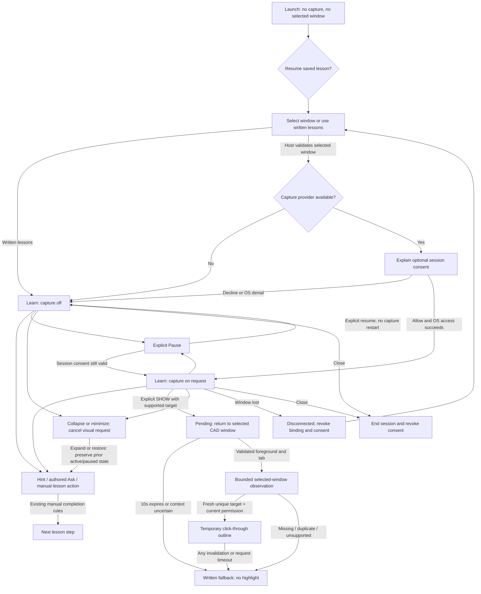

# Leqad desktop Compact Companion design

Date: October 25, 2026. Status: proposed complete design, awaiting owner approval. Direction approved; implementation is not authorized by this document.

## Purpose and source of truth

A standalone Windows teaching companion helps beginners follow Your First Sketch alongside CAD. It preserves the eight-step curriculum, progressive help, and honest evidence categories. The first desktop release is a feasibility prototype. It must remain useful through written lessons when control recognition is unavailable.

Sources inspected:

- Owner's Phase 1B desktop design brief and Compact Companion approval.
- PR #17, `feat/phase1b-desktop-foundations`, `d5f182a6f9cff4a14689d72e11f3779688dcaaa0`: product design, alpha testing workflow, and `packages/desktop-core/src/overlayPolicy.ts`.
- PR #15, Phase 1.5 presentation reference at `5dbd09dd8d2be1ce2080834dfad5e3cbc9a67be4`: `ContextualHelp.tsx`, `AskPrototype.tsx`, and teaching experience specification. Official branding is sourced separately from main.

PR #17 contains a pure overlay decision function. It does not provide Electron windows, a capture provider, reliable foreground/tab monitoring, native accessibility recognition, or a working desktop application. The extension's capabilities do not establish desktop support. These mockups are authored designs; no CAD screenshots, captured controls, recognition results, or authenticated observations are represented as real.

This design branch contains documentation and static design assets only. It does not change PR #15 or #17, merge their histories, or create an implementation PR. PR #17 currently reports conflicts against main; reconcile the baseline during later implementation planning, without silently combining the extension stack.

## Decision and alternatives

The owner selected Compact Companion: a movable vertical panel with a persistent lesson summary and one primary action. It preserves the existing teaching pattern and gives explanations readable line lengths.

The alternative was a slim lesson bar with expanding details. It occupies less width but requires more opening/closing and obscures lesson context when details are shown. It is not the selected design. No third window for help, conversation dashboard, or permanent settings sidebar is proposed.

Builder proposals in this document include exact dimensions, the five-second SHOW observation ceiling, a ten-second pending-request timeout, the pin preference, and the two theme token sets. They remain reviewable design choices, not implemented capabilities or previously measured desktop performance.

## Scope and anti-goals

Include selection, consent, teaching, progressive help, local Ask, settings, temporary highlights, recovery, and accessible resizing. Use Electron, React, and TypeScript as proposed in PR #17. Start on Windows; independently qualify Onshape and then a native CAD adapter such as FreeCAD.

Exclude AI services, cloud screenshots, unattended observation, automatic clicks or CAD edits, new lesson content, new model verifiers, auto-updaters, account systems, telemetry dashboards, and generic plugin marketplaces. Avoid promising reliable recognition merely because a control is visible in an image. Do not port browser selectors or browser-window measurements into desktop teaching components.

Success means a beginner can find the next instruction, request more help, understand unknown evidence, and stop observation. Desktop target placement and non-interference require separate real Windows acceptance.

## Design boards

Open `../../design/desktop-compact/mockups.html`. It is a static, locally rendered design gallery. Buttons demonstrate appearance only. Named PNG boards and a comparison sheet are in the adjacent `previews/` directory. Every board carries a design label outside the proposed product UI.

| Board | State and purpose                                                                  |
| ----- | ---------------------------------------------------------------------------------- |
| 01    | Initial launch, local CAD window selection, no capture permission                  |
| 02    | Explicit optional capture consent, written lessons remain available                |
| 03    | Normal compact lesson, recognition unavailable, self-report action                 |
| 04    | Expanded help, one selected topic, persistent lesson/action regions                |
| 05    | Ask local prototype and an authored response                                       |
| 06    | Hypothetical supported highlight over a schematic target, not CAD imagery          |
| 07    | Unknown recognition, written fallback and bounded retry                            |
| 08    | Paused session, no observation, explicit resume                                    |
| 09    | Disconnected session, progress retained, select window again                       |
| 10    | Settings, permission revocation, appearance, accessibility, placement              |
| 11    | Short/narrow window, one content scroller, reachable footer                        |
| 12    | Dark theme with expanded help                                                      |
| 13    | Multiple displays and lost-display recovery schematic                              |
| 14    | Compact collapsed state, no observation                                            |
| 15    | Permission denied or provider unavailable, written lessons continue                |
| 16    | Detailed guidance: supported SHOW, unavailable GUIDE, and consent-required variant |
| 17    | Waiting for CAD focus and inspecting, both with Cancel                             |
| 18    | Informational acknowledgement, self-reported completion, and final summary         |
| 19    | Resume a saved lesson or confirm starting again                                    |

## Component hierarchy and reuse

```text
Desktop host: window lifecycle, OS boundary, permission/capture session
  Typed preload bridge: allowlisted requests and validated events only
  Companion renderer
    Header: approved mark/name, window menu, collapse, close
    Selection view OR consent view OR teaching workspace
    Teaching workspace
      Session strip: selected app alias, capture/request status
      Learn / Ask navigation
      Persistent lesson context: title, step, goal, completed count
      Instruction OR bounded help OR authored Ask example
      Evidence summary
      Primary lesson action + Back / Pause
    Settings view: returns to its invoker
  Separate highlight window: non-focusable, click-through, no controls
```

These are responsibilities, not a mandate to create one file per node. Use one state owner per concern. Do not introduce a generalized workflow framework.

Reuse `packages/lesson-engine` and `packages/contracts` after checking the chosen baseline. Preserve outcomes, ordered hints, explicit progression, and lesson identifiers. Reuse the visual structure of `ContextualHelp` and `AskPrototype`; extract only portable presentation during later implementation. `AskPrototype` currently imports guidance types from extension services, so it is not portable as-is. Supply closed platform-independent identities through a small shared type boundary. `AssistantPanel` remains the extension orchestrator and must not be imported wholesale.

Desktop position persistence, Electron lifecycle, and permissions live outside lesson state. Reuse content and evidence meanings without copying `window`, DOM recognition, WXT APIs, extension storage adapters, or CSS viewport placement logic. Do not migrate or overwrite extension user preferences. A desktop store can have its own versioned envelope while retaining compatible lesson semantics; exact storage mechanics belong to implementation planning.

## Geometry, hierarchy, and tokens

All dimensions below are logical pixels / Windows DIPs, not device pixels. Screenshots illustrate 100% scale. Actual OS text/display scaling must be tested later.

| Element                    | Specification                                                                                                                                                                                                                              |
| -------------------------- | ------------------------------------------------------------------------------------------------------------------------------------------------------------------------------------------------------------------------------------------ |
| Initial selection window   | 560 × 620 preferred; minimum 320 × 400 subject to available work area                                                                                                                                                                      |
| Teaching window            | 365 × 600 preferred; resize width 320–480, height 400–760; fit work area first                                                                                                                                                             |
| Expanded help              | Same window size; never automatically grow the OS window                                                                                                                                                                                   |
| Collapsed                  | 280 × 112 preferred; contains step, Expand, Pause/Resume, close menu                                                                                                                                                                       |
| Work-area margin           | 8 minimum; first placement 16 from chosen work-area edge, never guess CAD control locations                                                                                                                                                |
| Header                     | 56 high; mark 33 × 33, left inset 16, name gap 8                                                                                                                                                                                           |
| Body                       | 16 horizontal padding; 16 between major groups, 8 related controls, 4 label/value                                                                                                                                                          |
| Session strip / navigation | Minimum 40 each, expands for wrapped status; no fixed clipping height                                                                                                                                                                      |
| Buttons                    | Main actions minimum 40 high, 12 horizontal padding, radius 4, 8 gap; touch goal 44. Compact header, footer-secondary, topic, and disclosure buttons are 32 minimum; navigation is 36 minimum. All exceed 24px targets and grow with text. |
| Primary action             | Full available width; one navy-filled action per view                                                                                                                                                                                      |
| Footer                     | Intrinsic height, 16 padding, 8 gaps; separator only when necessary                                                                                                                                                                        |
| Help content               | Maximum min(220, 30% of window content height), shrinks to remaining space                                                                                                                                                                 |
| Border                     | 1px structural border; no decorative shadows or layered cards                                                                                                                                                                              |
| Overlay                    | 2px navy inner outline and 2px ivory outer outline, 4px outside target; square geometry, no fill                                                                                                                                           |

No mandatory minimum exceeds the available display work area. If work area or text scaling cannot fit the normal layout, use the compact fallback below. Buttons wrap and grow; instructions never use ellipsis. Selected app titles may truncate with an accessible full local name.

| Typography                 | Font / size / line height / weight |
| -------------------------- | ---------------------------------- |
| App name                   | Space Grotesk / 20 / 24 / 600      |
| Step heading               | Space Grotesk / 20 / 26 / 600      |
| Selection heading          | Space Grotesk / 24 / 30 / 600      |
| Main instruction and help  | Manrope / 14 / 21 / 400            |
| Button                     | Manrope / 14 / 20 / 600            |
| Status, evidence, progress | Manrope / 12 / 18 / 500            |

Bundle licensed local fonts in a future runtime. The design assets include the actual fonts and OFL licenses; no remote font request is needed to view them. Fallback is system sans-serif if font loading fails. No geometry or palette substitution is applied to the approved primary SVG. Its official center is Hay's Russet `#793327`.

| Token                | Light                 | Dark                                                                 |
| -------------------- | --------------------- | -------------------------------------------------------------------- |
| Base                 | `#F5EFE7`             | `#191919`                                                            |
| Content              | `#FFFAF3`             | `#2B2B2B`                                                            |
| Main text            | `#0E2943`             | `#F3F0EB`                                                            |
| Secondary text       | `#55514D`             | `#C9C1B8`                                                            |
| Secondary hover      | `#E8DED2`             | `#3B3834`                                                            |
| Primary fill / text  | `#0E2943` / `#FFFFFF` | `#F5EFE7` / `#191919`                                                |
| Accent               | `#793327`             | `#E8B7A5` for text; russet retained where it has sufficient contrast |
| Focus                | 2px navy, 2px offset  | 2px ivory, 2px offset                                                |
| Interactive boundary | `#79716A`             | `#A49A8E`                                                            |

Use color with text state labels. No ornamental dots, gradients, glows, flashing, or animated progress. A 3px progress rule indicates steps completed and has a textual equivalent. It does not indicate geometry correctness. Hover must retain >=4.5:1 text contrast, including the dark theme regression against ivory hover with light text. Focus and essential non-text boundaries require >=3:1 against adjacent colors. Disabled controls retain a nearby explanation; do not reduce essential copy opacity.

### Control interaction states

| Control                     | Default / selected                                                                                 | Hover / focus / unavailable                                                                                           |
| --------------------------- | -------------------------------------------------------------------------------------------------- | --------------------------------------------------------------------------------------------------------------------- |
| Primary lesson action       | Primary fill and on-primary text; label from current lesson outcome                                | Hover retains palette with underlined label; focus uses offset outline; disabled retains readable reason              |
| Secondary action / question | Content background; selected topic/question uses secondary-hover background and selected semantics | Hover uses secondary-hover token; keyboard focus adds outline; unavailable has no activation and adjacent explanation |
| Help disclosure             | Plain text, expanded state and content relation                                                    | Underline on hover; focus outline; Escape restores trigger focus                                                      |
| Window/theme selection      | Native radio semantics, no initial window selection                                                | Whole row target; selected marker plus text; keyboard arrows follow native radio behavior                             |
| SHOW in progress            | Text status plus Cancel; repeated SHOW unavailable until cancellation                              | No spinner needed, no flashing; meaningful state change announced once                                                |
| Settings / return           | One view in the same native window                                                                 | Focus moves to view heading and returns to invoker; opening settings cancels visual work                              |

Static boards illustrate these states; mockup controls are not wired to a lesson or OS. Future production controls need accessible names such as Open menu, Collapse panel, and Close session. Header “−” means collapse in this design; native Minimize remains in the system/window menu. Do not use the collapse glyph as an unlabeled production control.

## Screen behavior and exact copy

### 1. Launch and window selection

Title: "Learn alongside your CAD workspace". Supporting text: "Choose a window for this session. Written lessons work without screen capture."

A locally obtained window list uses application name and a transient ordinal, for example "Chrome · Window 1". Examples in mockups are illustrative. Do not claim the app contains Onshape based on Chrome's presence. Native window selection may reveal the actual title locally for disambiguation through an explicit "Identify window" action or OS picker, without logging/exporting it. Do not request screenshots/thumbnails to populate the initial list. If the provider cannot enumerate windows safely, show "Window selection isn't available in this build" and offer written lessons.

Radio rows provide selection, then primary "Use selected window". Selection creates a session binding only after the host validates the window still exists. It does not grant capture permission, editing permission, recognition, or verified geometry. Secondary "Use written lessons" creates an unbound teaching session. Refresh requires explicit action. No default window or automatic consent.

### 2. Consent

Title: "Allow visual help for this session?"

Copy: "Only the window you selected. When you request SHOW, Leqad may inspect its interface controls and capture images of that window for up to 5 seconds. It stops sooner if focus or permission changes. No control inspection or capture between requests. Images stay in memory and are not saved or uploaded."

List the selected app alias and "Control recognition may still be unavailable." Buttons: primary "Allow for this session", secondary "Continue without capture". Consent is off initially and never persisted across app restarts, target changes, or disconnected sessions. The host must not request image frames or thumbnails before consent. Any OS prompt follows the explanation. Denial returns to written teaching with "Capture not allowed. Written guidance is available."

Only offer Allow if a real capture provider exists and respects the stated boundary. Otherwise use board 15: "Visual help isn't available in this build." No fake permission toggles. Screen-only capture is not silently substituted for selected-window capture.

### 3. Compact lesson

Session strip: "Chrome · Window 1" and "Capture off" or "Capture on request". Avoid a green Connected badge.

Context: "Your First Sketch", "Step 4 of 8", "3 steps completed · CAD work unverified". Step title: "Draw a Corner Rectangle". Goal: "Create the rectangular profile." Next action: "In Sketch, choose Corner Rectangle. Place one corner, then the opposite corner."

Help disclosure starts closed. Evidence: "Not checked. Marking this step done records your report." Primary "Mark done" for this unverified modeled operation; after success, evidence becomes "Marked done by you. CAD geometry has not been verified." and primary becomes "Next step" according to existing rules. Informational steps retain acknowledgement. If an existing verifier is truly available, preserve Check progress and its actual scope. No new geometry PASS source.

Back and Pause remain secondary. No selection, highlighting, hover, capture, help, Ask answer, or observation automatically advances the lesson. Restart is in the lesson menu with explicit confirmation; it never resets capture consent or unrelated preferences implicitly.

### 4. Progressive help

Open Help reveals the next appropriate authored hint using existing hint history. Topics: Hint, Detailed guidance, Why it matters, and Unable to verify when relevant. Show one topic at a time. Changing topics does not invoke SHOW or GUIDE. "More help" advances the existing hint sequence only on request.

HINT is written help and needs no capture or editing permission. SHOW can inspect only a supported target after consent and context checks. GUIDE is unavailable unless a supported sequence and its transitions are independently established. Disabled SHOW/GUIDE explain why immediately beside the group; no tooltip-only explanation. Do not offer an apparently enabled button for a nonexistent provider. A consent setup link is distinct from an enabled recognition action.

Persistent context, evidence, and primary action stay visible at normal size. On closing Help or changing step, cancel any pending visual request and hide the overlay. Help topics reset on step changes; saved hint usage does not reset.

### 5. Ask

Persistent label: "Local prototype · no AI connected". Context remains visible above the question area. Authored question: "Why use Corner Rectangle?" Response label: "Local example". Answer: "Corner Rectangle uses two opposite corners. It suits this lesson's corner-based rectangular profile. Center Rectangle starts from a center point instead."

Evidence sentence: "This explanation does not check your sketch." No free-text field, typing animation, chat transcript, network request, or implied perception. Other authored examples can address the current hint and why Leqad cannot verify the work. Select one answer; replace it on selecting another. Changing step clears the answer; returning to Learn retains lesson state. Ask never initiates capture or highlighting.

### 6. Unknown and recovery

| Trigger                               | Copy                                                                   | Action and preserved data                                                    |
| ------------------------------------- | ---------------------------------------------------------------------- | ---------------------------------------------------------------------------- |
| No target capability                  | "Visual guidance for this control isn't available yet."                | Read the written steps; no capture request                                   |
| Missing target                        | "I couldn't locate a reliable target. Follow the written steps below." | Retry only if the adapter is available; never loop automatically             |
| Multiple candidates                   | "More than one control matched. No highlight shown."                   | Written guidance; recheck on explicit retry                                  |
| Browser tab unknown                   | "The active CAD tab can't be confirmed. Highlight hidden."             | Return to intended tab; retry only after evidence is supported               |
| Stale observation                     | "The view changed. Request SHOW again."                                | Discard result; preserve step                                                |
| Overlay overlaps panel                | "Move Leqad clear of the control, then try again."                     | No auto movement based on guessed CAD layout                                 |
| Permission revoked                    | "Capture stopped. Written guidance is still available."                | Grant again explicitly if supported                                          |
| Window closed/replaced                | "Selected window is no longer available."                              | Select a window; new binding and fresh consent                               |
| Capture failed                        | "Visual help couldn't start. Nothing was captured successfully."       | Retry or continue written; never claim this if a frame was actually captured |
| Capture succeeded, recognition failed | "A view was inspected, but the control couldn't be identified."        | Discard frame; written fallback                                              |
| Save failed                           | "Progress couldn't be saved on this device."                           | Retry save; retain in-memory state; no Saved badge                           |

A retry replaces the prior request, clears its highlight first, and rechecks permission/window/context. One pending request at a time. Repeated failures do not open dialogs repeatedly. "Report misaligned highlight" first clears the overlay, then offers an optional local report preview containing only version, fixed reason codes, display scaling, and anonymous numerical bounds. No automatic export/upload, raw images, names, URLs, IDs, or credentials. No report backend in this milestone.

### 7. Pause, disconnect, and exit

Pause stops the current request, releases image buffers, hides overlays, and shows "Paused. No observation running." Written context remains visible; Resume restores lesson interaction only, not capture. Existing session consent may remain in memory while paused, but a new explicit SHOW is always required. Capture revocation while paused is immediately respected.

Minimize, collapse, and close cancel pending requests and hide overlays. Collapse and minimize preserve the current lesson active/paused state; they do not implicitly pause or resume it. Expand restores that state and never restarts visual work. Close exits the session, revokes consent, and saves only permitted lesson/preferences data. No tray background observation or auto-start. Disconnect revokes the session binding and consent; selected-window handles are not restored on restart. Resume saved lesson progress is offered independently of choosing a new window.

### 8. Settings

One view in the same window, reachable from the header menu. Controls: Appearance System/Light/Dark; Text size 100/125/150/200%; Keep panel visible on top; Reduce motion follows Windows plus explicit reduce option; default help level restricted to supported levels; capture state/revoke; Change window; Report misaligned highlight.

Keep visible is on for an active teaching session as a proposed convenience default, visibly togglable in the menu; it does not steal focus or raise the overlay over unrelated applications. Selection and consent windows are ordinary windows. Native minimize/close and keyboard window movement remain available. Desktop settings never rewrite extension preferences. No automatic screenshot or diagnostic export.

### 9. Resume and completion

On launch with saved progress: "Continue Your First Sketch?" plus "Step 4 of 8 · 3 steps completed" and "Saved lesson progress does not describe your current CAD model." Primary "Resume lesson" opens selection or written-only teaching. Secondary "Start again" asks "Reset this lesson’s progress on this device?" with Cancel and Reset lesson. It does not delete preferences. Never restore a selected window, capture consent, or past observations as current context.

Informational step: primary "Got it" records ACKNOWLEDGED; afterward show "Instruction acknowledged" and Next step. Modeled operation without a verifier: Mark done records SELF_REPORTED; afterward show "Marked done by you. CAD work unverified." and Next step. The design must use the engine's actual allowed transition, including existing continue-without-verification behavior where applicable; it does not replace gates.

After the final allowed transition, show "Lesson completed" and "8 steps completed. CAD work is not independently verified." when that matches the stored outcomes. Below, provide a readable per-step list with its actual outcome category, including any acknowledged, self-reported, or independently verified checks. Never hardcode that all steps were self-reported or verified. Primary "Review steps" returns to the first step without resetting progress. Secondary "End session" exits. Restart remains confirmed in the menu. No confetti, certificate, or model-success badge. Board 18 contains illustrative outcome values only.

## Complete interaction flow



Resume routes to exactly one state based on current permission, not both. Help/Ask can return to Learn from any non-ended session without changing outcomes. All states can close through the native window command. Any active request is canceled on navigation, pause, settings, window change, or termination. Failed saves remain visible before normal exit where possible; crash durability is an engineering test obligation.

## Desktop permission and overlay contract

Keep separate state machines for lesson progress and visual requests. A visual request cannot mutate completion outcomes.

Session binding states: unbound, selected, consent-required, permitted-on-request, disconnected, ended. Lesson pause is independent of binding state; it gates visual requests and can coexist with a valid in-memory grant. Capability states: unsupported, available, uncertain. Visual request states: idle, waiting-for-CAD-focus, inspecting, highlighted, unavailable, canceled. Use fixed reason codes from the adapter for detailed troubleshooting, concise text in the panel.

Before consent, only selected-window liveness and foreground metadata may be monitored locally to maintain the explicit binding. A future validated browser bridge may provide opaque active-tab identity for that selected window; no URLs or content are persisted. This metadata does not grant control inspection. Native accessibility control/tree reads, screenshots, and target localization require session consent and occur only inside the bounded SHOW request. No semantic control inspection while paused, unbound, or between requests. The metadata provider's own permissions must be independently respected.

1. SHOW is an explicit user request for a closed supported action ID, never a selector or script. The host validates input, consent, session binding, and capability. The renderer cannot grant itself permission or submit authoritative rectangles.
2. Clicking SHOW focuses Leqad. Display "Return to your CAD window to show the control. Request expires in 10 seconds." Observe no image until foreground and, for browsers, active tab are independently established. Use Alt+Tab or the user's normal window selection; never automatically activate CAD or click it. Cancel is available. If no reliable foreground/tab provider exists, fail immediately with a written fallback.
3. Successful handoff ends the ten-second pending deadline. At that moment a separate observation deadline begins. The explicit request allows at most five seconds of selected-window observation, solely to maintain current placement if the adapter needs new frames. No polling capture between requests. Permission text must match the actual backend. One-shot capture cannot justify a five-second stale rectangle.
4. Reuse PR #17's pure policy gates: capture authorization, target visibility, correct foreground, authoritative browser tab identity, fresh unique observation from the same context, finite valid bounds, screenshot/content mapping. Current 750ms observation age and 0.9 confidence gates are prototype constraints, not calibrated accuracy claims. A high numeric confidence alone never establishes a supported target identity.
5. Overlay hides on any invalidation immediately upon receiving the host event. A watchdog also expires stale evidence by 750ms. A five-second request ceiling is not a 750ms grace period on known invalidation. Race-prone late results are ignored using a session/request generation. Restart, resize, zoom, minimize, tab change, display change, changed layout, disconnection, and revoked consent invalidate existing coordinates.
6. Only validated content-to-screen transforms may position the outline. Never apply outer-window offsets guessed from screenshots. For partial occlusion, target covered by Leqad, display mapping uncertainty, unsupported DPI mapping, or uncertain context, abstain. Do not draw on a different monitor because its coordinate happens to fit.
7. The overlay is a separate transparent native window, non-focusable and click-through at the OS level. CSS pointer-events is insufficient. No tooltip, label, button, keyboard handler, or screenshot is rendered over CAD; feedback stays in the companion. Native behavior must be tested. If native pass-through or focus behavior is unvalidated, keep live overlays unavailable.
8. Clicking back into Leqad immediately clears the CAD outline. A request does not resume when focus returns unless still within a valid explicit request and a fresh result is obtained; after a known focus-loss event, cancel the request entirely for deterministic behavior. The user can request SHOW again.
9. Source/frame memory is released after evaluation or cancellation; latest-needed frame only within a request. No persisted screenshots, arbitrary text, or raw accessibility trees. Avoid claims of forensic memory erasure. Debug screenshot export, cloud processing, and continuous capture are out of scope.

## Responsive, multi-display, and keyboard behavior

The teaching window is movable through its header excluding interactive controls. Windows system-menu Move/Size must remain available through Alt+Space or an accessible equivalent if custom chrome changes native behavior. Provide "Move panel" and "Reset position" in the menu; keyboard movement uses the native operation. No invisible drag-only affordance.

At ordinary dimensions the context and footer do not scroll. Help scrolls internally; Ask uses the same bounded content region. At <560 logical px available height, narrow 320px width with enlarged text, or actual content overflow, switch to a single body scroller, remove internal help scrolling, and keep header/footer only if enough height remains. At extreme text/work-area constraints use one whole-content scroller with all controls reachable. Never promise all content is pinned when it physically cannot fit. Do not shrink text to compensate. Use CSS first, a single overflow measurement only if tests require it.

Work-area placement excludes taskbars. Support negative-coordinate monitors and per-monitor DPI, with no raw pixel/DIP mixing. Dragging the teaching panel between displays invalidates any overlay. Moving CAD between displays requires a fresh mapping and observation. Never resize or move CAD itself. When a display disappears, restore the panel fully onto an available work area; cancel observation and show "Display changed. Visual help stopped." Store only relative panel placement/size and non-sensitive display layout preferences as needed, not raw window titles or persistent capture handles.

The panel can cover CAD controls; there is no universal safe location. Minimize, collapse, manual movement, and pin toggling remain available. The app must not claim unobstructed CAD merely because the overlay is click-through. No automatic docking, snapping to toolbars, or CAD layout inference in this milestone.

## Accessibility acceptance requirements

- All controls keyboard reachable in visible reading order. Native radio groups for window/theme choice; native buttons for help topics with selected state. No hover-only action.
- Visible focus with >=3:1 contrast, >=2px indicator, not hidden behind sticky regions. Minimum 24×24 accessible targets; designed buttons >=40px.
- Text >=4.5:1 in default, hover, active, selected, and error/uncertain states in both themes. Use the existing contrast measurement approach where feasible, but actual Electron rendering needs its own host acceptance.
- OS 100%, 125%, 150% display scaling; app text at 200%; 320px effective width; multi-monitor negative coordinates; high-contrast/forced-colors mode. Never infer native DPI correctness from a browser viewport test.
- Narrator names each region, step, permission, and selection. Polite live region announces meaningful evidence/request changes once. Countdown is not announced every second. No recognition result steals focus.
- Opening Settings moves focus to its heading. Return restores the invoking control. Help Escape closes help and restores disclosure focus; Escape within the app may cancel a visual request before closing secondary content, with explicit status. No global keyboard interception in CAD.
- Error feedback names the problem and recovery. Consent can be declined without losing lesson access. Disabled visual controls expose their reason in normal text.
- Reduced motion disables cosmetic transitions; the overlay never pulses even without reduced motion. Native Windows focus and high-contrast behavior require live verification.

## Evidence vocabulary and boundaries

| Evidence                         | Presentation                                            | What it must not imply                                          |
| -------------------------------- | ------------------------------------------------------- | --------------------------------------------------------------- |
| No supported current observation | "Unable to verify" / specific unknown reason            | That a control is absent or CAD operation failed                |
| Actual supported UI fact         | "Observed: [specific UI fact]. Geometry not checked."   | A click, editing permission, saved model, or correct dimensions |
| Existing UI_VERIFIED outcome     | Name exactly the interface check                        | MODEL_VERIFIED                                                  |
| Existing MODEL_VERIFIED outcome  | Only if an independent implemented verifier supplied it | Availability in this desktop milestone                          |
| SELF_REPORTED                    | "Marked done by you. CAD work unverified."              | Verified geometry                                               |
| ACKNOWLEDGED                     | "Instruction acknowledged"                              | A CAD operation happened                                        |
| Lesson completed                 | Completed steps plus their evidence categories          | CAD correctness or certification                                |

Observation history is not fresh context. Progress may remain completed while current CAD state is unknown. No UI event upgrades evidence level. Copy for successful capture means only an image was obtained; it cannot say the model is understood.

## Engineering handoff and unresolved feasibility

Proposed seams, to refine during implementation planning:

| Owner                     | Inputs/outputs                                                                                | Prohibited coupling                                              |
| ------------------------- | --------------------------------------------------------------------------------------------- | ---------------------------------------------------------------- |
| Teaching renderer         | Lesson view model, evidence summaries, authored examples, callbacks                           | OS handles, native capture, selectors, filesystem, arbitrary IPC |
| Electron main / preload   | Closed requests for select, consent, show, cancel, stop; bounded status events                | Renderer-supplied permission or trusted recognition boxes        |
| Platform context provider | Selected-window liveness, foreground, content bounds, display generation                      | Treating browser window focus as active-tab identity             |
| CAD adapter               | Closed target ID and bounded current authorized observation to supported candidate or UNKNOWN | Guessing controls, sharing support assumptions across CAD apps   |
| Overlay policy / host     | Current validated candidate and context to visibility and placement                           | CAD input injection, progress changes, stale results             |
| Persistence adapter       | Existing lesson semantics, desktop-only preferences                                           | Screenshots, raw titles/URLs, capture consent or session handles |

Renderer must run with context isolation, sandboxing and no Node integration. Validate both ends of the narrow bridge. Restrict navigation and new windows; no remote content or arbitrary execution. These are future implementation requirements, not claims about an existing host.

Known gaps: selected-window capture mechanism, native foreground/occlusion events, reliable Onshape tab identity, supported target localization, true content bounds, secure exclusion of the companion from captured imagery, mixed-DPI transforms, and native click-through. Investigate each independently. Do not choose an unreviewed bridge or cloud vision dependency to make the mockup appear functional. If the host cannot uphold capture consent or overlay safety, ship only a clearly labeled written-lesson prototype until resolved.

Actual fonts introduce licensed distribution files, not a runtime network dependency. The four immutable official SVGs come from main at df1879e, governed by docs/branding/official-logo.md, and match the official website branding. PR #15 supplies teaching presentation references only, not authoritative branding.

## Proposed implementation phases, after design approval

1. Write a detailed plan with shared contracts, selected baseline, explicit file ownership, and acceptance cases. Reconcile PR #17's conflicts separately from visual work; no merges authorized.
2. Build the local Electron teaching prototype and isolated host bridge, with authored lesson/Ask data and honest unavailable capture/recognition. Reuse portable presentation deliberately; preserve the extension.
3. Validate selected-window enumeration and explicit consent, then native foreground/lifecycle and synthetic overlay placement. Keep all simulated results labeled. No real-CAD overlay until the safety path is demonstrated.
4. Introduce one evidence-supported CAD target path and validate actual Windows capture, identity, DPI, focus loss, pass-through, and cancellation. Onshape and FreeCAD have independent gates; one passing adapter does not certify another.
5. Owner acceptance, accessibility review, and packaging review. Installer signing/updater and distribution are later decisions.

For later planning, the approved three-agent division remains: teaching presentation/local Ask; desktop host/session/consent; overlay/recovery/testing. Use common types and tokens agreed before edits, separate file ownership, and primary-agent integration. Use exactly three GPT-6 Luna agents with max reasoning, per the latest owner instruction; report a blocker rather than substitute a model if unavailable. No implementation agents are launched during this design-only task.

## Design review and approval gate

An independent review accompanies this document in `../../design/desktop-compact/review.md`, including important questions and dispositions. Local mockup rendering checks are documentation QA only. No production tests, live Windows runtime validation, Onshape acceptance, or deployment is claimed.

Owner review covers the compact layout, same-window help/Ask, exact consent wording, written-only fallback, request timing, collapse/pause behavior, and visual hierarchy. After approval, proceed to Superpowers writing-plans. Do not start production code, dependency installation, implementation PRs, merge, or deployment as part of design approval delivery.

## Official branding correction

The active design uses the official circular emblem and custom vector wordmark from `main` at `df1879e223b055583a0a8d150438483afebdb085`, governed by `docs/branding/official-logo.md`. Horizontal light/dark lockups occupy a 132 × 36 DIP object-fit box, aligned left in the existing 56px header. The collapsed header uses the 33 × 33 DIP symbol. No font-generated wordmark remains. All four SVG files retain exact source bytes. The older square asset is removed from the design pack. Layout, Settings, Help scrolling, SHOW deadlines, and completion navigation are retained.

## Final cleanup for planning

Status: final design cleanup complete; implementation plan requires owner approval. All official SVG bytes are unchanged.

Settings exposes Stop / revoke visual access, Change window, Reset panel position, and Report misaligned highlight in one named scroll region. One footer action returns to the invoking view: Back to lesson when opened from Learn, Back to Ask when opened from Ask. Restore focus to the original Settings invoker. No redundant Back, Close settings, or Return actions. Reset position clamps the panel into the current work area without moving CAD; it clears pending highlights.

Comfortable Help content requires at least 126 logical pixels at 100% text, or six rendered body line heights when text is enlarged. If the bounded region cannot provide this, use one body scroller and disable internal help scrolling. This applies at the default 365 × 600 as well as smaller windows. Context remains reachable; evidence and primary action remain pinned where space permits. One overflow measurement may supplement CSS if required.

The eight-step completion summary is a named, keyboard-focusable scroll region with a visible scrollbar and Scroll to review all 8 steps text. Tab reaches it; PageDown/End must reach step 8 without changing progression. Review steps preserves progress; End session remains secondary.

SHOW timings of 10 seconds pending, 5 seconds observation, and 750ms evidence freshness are conservative prototype parameters requiring real Windows usability and safety testing. They are not validated performance promises. Expiry clears the request and returns a written fallback; Retry starts a new explicit request and repeats all permission/context checks. Cancel immediately clears pending work and overlay; late results cannot restore it. No automatic retry.
